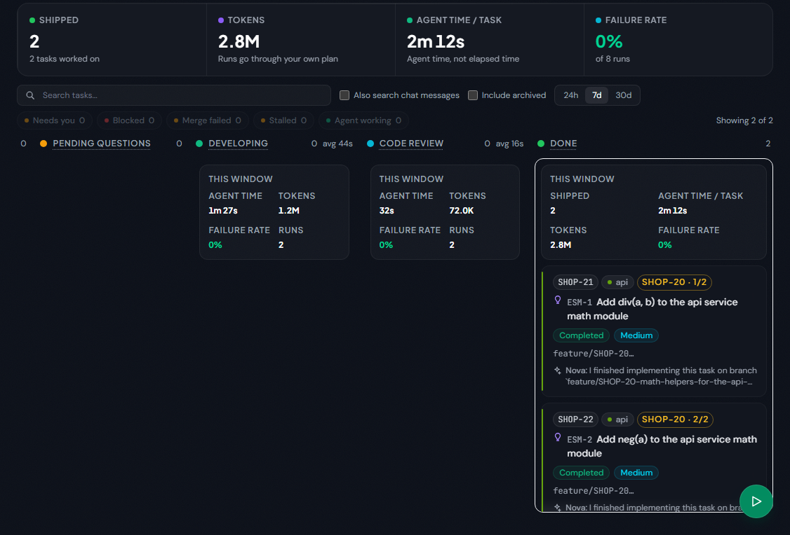
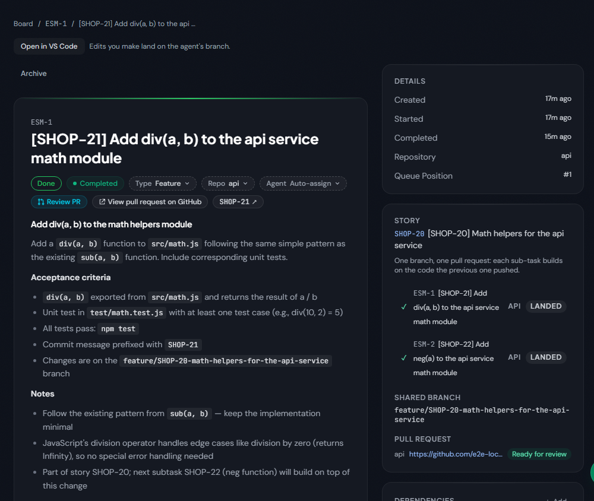
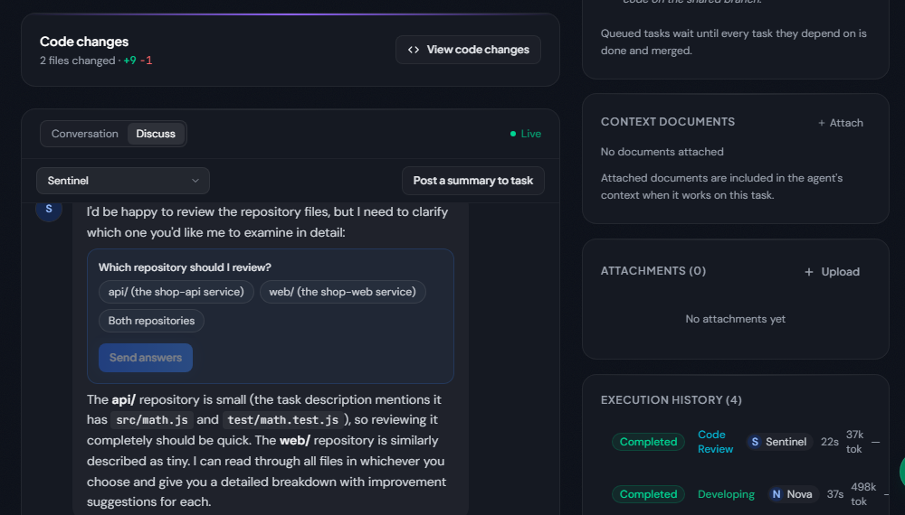
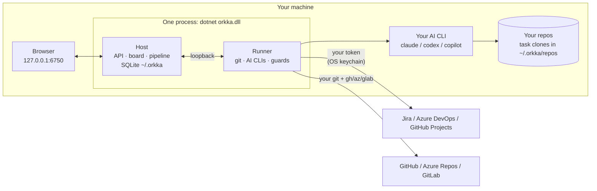

<p align="center">
  
</p>

<p align="center">
  <b>Your Jira, Azure DevOps and GitHub Projects tickets, worked by an AI dev team on your own machine.</b><br>
  You keep your git credentials, your AI subscription and your code. Orkka provides the board, the pipeline and the guardrails.
</p>

<p align="center">
  <a href="https://github.com/ruanpelissoli/orkka/actions/workflows/ci.yml"></a>
  
  
  
</p>

<p align="center">
  <a href="#-the-60-second-tour">Tour</a> ·
  <a href="#-how-it-works">How it works</a> ·
  <a href="#-quick-start">Quick start</a> ·
  <a href="#-security-model">Security</a> ·
  <a href="#-reference">Reference</a>
</p>

---

## Why Orkka?

If you work several jobs or clients at once, each has its own tracker, repositories and rules.
Orkka points a persistent, named AI team (**PM, developers, QA and a reviewer**) at the tickets assigned to you,
and runs the whole loop on your laptop:

> ticket assigned to you → plan → you approve → code → tests → review → **pull request on your forge** → ticket moves to *Code Review*

| | |
|---|---|
| 🏠 **Local-only** | One process on `127.0.0.1`. No account, no server and no telemetry. Data lives in `~/.orkka`. |
| 🔑 **Your credentials** | Git pushes with *your* sign-in, and PRs open with *your* `gh` / `az` / `glab`. Tracker tokens stay in your OS keychain. |
| 🤖 **Your AI subscription** | Claude Code, Codex (ChatGPT) or Copilot CLI, on any sign-in type: a personal or team plan, an API key, Bedrock, Vertex, Azure OpenAI or a company gateway. |
| 🧭 **Your workflow** | Statuses are configurable per project. Pick which tracker statuses to take tickets from, and which status each step moves them to. |
| 🧑‍💼 **One workspace per job** | Projects, tracker connections and AI sign-ins are kept apart per employer. |
| 🛡️ **Guardrails** | Agents can't push, read your keys, reach other hosts or leave their task folder. These limits are enforced on your machine. |
| 📦 **Nothing installed** | `git clone` and `./orkka start`. No installer and no PATH changes. Uninstalling means deleting two folders. |

---

## 🎬 The 60-second tour

### 1. Point Orkka at a folder

Create a project from **one folder on your machine**, either a monorepo or a folder with several repositories.
Orkka finds the repositories and reads where each one pushes:
- a repository with an `origin` gets a pull request on your forge;
- one without an `origin` gets work squash-merged locally.

### 2. Connect your tracker

Add a Jira Cloud, Azure DevOps or GitHub Projects connection. The token goes straight into your OS secret store and never into Orkka's database.
For GitHub you can skip the token entirely and use your own `gh` login (github.com, or your GHE.com host for Enterprise Managed Users): Orkka asks `gh` for it at each call and stores nothing.
Then choose:
- which statuses to **pick up** from (for example *To Do*);
- what each step **moves the ticket to** (*In Progress*, *Code Review*, …, or *don't change*).

### 3. Tickets become tasks

Every ticket assigned to you in a pickup status lands on the board.
Orkka opens on the **workspace board**: every task of the workspace (one per job) across all its projects, with a filter to narrow it to one project.
A **Story** with sub-tasks (on GitHub: an issue with sub-issues) becomes one shared branch with one pull request, and its sub-tasks are worked in tracker order.

<p align="center"></p>

### 4. Watch the team work, and step in when you want

Each task shows its plan, its code changes and its full history:
- **approve the plan**, or send it back;
- answer the agent's questions;
- review the diff.

For a Story, every sub-task is reviewed on **its own change only**, even on the shared branch.

<p align="center"></p>

### 5. Discuss before (or after) it runs

The **Discuss** tab is a direct, read-only chat with the task's agent about the ticket, the repository and the plan.
"Post a summary to task" turns the conversation into instructions for the run.

<p align="center"></p>

### 6. The pull request is yours

When review passes, Orkka pushes the branch and opens the PR **with your own forge CLI**, and the ticket moves to the status you mapped.
Your team reviews and merges it like any other PR. Orkka never merges on your forge.

---

## 🧩 How it works



- **The host** holds the board, the pipeline and the database, which is one SQLite file.
- **The runner** does everything that touches your machine: git, the AI CLIs, the tracker calls and the guards. It talks to the host over loopback, using the same protocol as a runner on a second machine.
- **The pipeline:** PM refines → developer plans → **you approve** → developer codes → *your* check command (lint, typecheck, tests) gates the result → QA → reviewer → pull request. Any step can ask you a question, and tasks can move backwards.
- **The extras:**
  - project **memory** that agents recall by relevance;
  - per-project **skills**;
  - **autopilot** windows and per-task **spend limits**;
  - an **MCP server** for Claude Code or Cursor;
  - a **Run** button that starts your app locally.

---

## 🚀 Quick start

You need:

| | Why |
|---|---|
| [.NET 10 SDK](https://dotnet.microsoft.com/download/dotnet/10.0) (10.0.300+) | builds and runs Orkka |
| [Node.js 20+](https://nodejs.org/) | builds the web UI. Only at build time; nothing runs on Node |
| [git](https://git-scm.com/downloads) | your repositories, with your own sign-in |
| An AI CLI, signed in | Claude Code (`claude` → `/login`), Codex (`codex login`) or Copilot CLI (`copilot` → `/login`) |
| *Optional:* `gh` / `az` / `glab` | to open pull requests on your forge; `gh` (with the `project` scope) also lets a GitHub Projects connection use your login instead of a token |

```sh
git clone https://github.com/ruanpelissoli/orkka.git
cd orkka
./orkka start          # Windows: orkka start (cmd)  or  .\orkka start (PowerShell)
```

The first start installs the UI's npm packages, builds everything, and opens <http://127.0.0.1:6750> with a one-time sign-in link.
Later starts rebuild only what changed. Orkka runs in the foreground, and **Ctrl+C stops it.**

| Command | What it does |
|---|---|
| `./orkka start [--port N] [--no-browser]` | Build and run Orkka (default port 6750) |
| `./orkka open [--print]` | Sign a browser in again with a fresh one-time link; `--print` only prints it |
| `./orkka status` / `./orkka stop` | Is it healthy? / stop it from another terminal |
| `./orkka tracker add jira …` / `ado …` / `github …` | Connect a tracker from the terminal (you can also use Settings → Trackers) |
| `./orkka workspace …` | Jobs on this machine, plus per-job git identity and AI sign-in |
| `./orkka commands …` | Approve the repository commands (setup, check) that agents may run |
| `./orkka doctor` | Diagnose an AI CLI that shows as "not ready" |
| `./orkka help` | Everything else |

**Update:** `git pull && ./orkka start`. **Uninstall:** see [below](#uninstall).

---

## 🛡️ Security model

Orkka was built to pass a corporate security review. The short version:

- **Nothing is installed.** There's no PATH, registry, service, autostart or global git config change; before/after snapshots of a start and stop come out identical.
- **One listener**, on `127.0.0.1` only. Browser sessions come from one-time launch codes. The host allowlist, CSRF and origin checks are always on.
- **No credentials held.** Orkka stores no git, forge, tracker or AI credential. Tracker tokens live in the OS keychain, and the runner's own token expires and rotates.
- **Agents are fenced in on your machine:**
  - they can't push, read keys or sign-ins, open dotenv files outside the task, call other hosts, or run cloud CLIs;
  - their environment is scrubbed of secrets;
  - repository commands run only when the repository declares them or you approve them.
- **Your code stays put.** Diffs are read live from your machine, and the database keeps file paths and line counts only.
- **Supply chain:** NuGet and npm packages are pinned by lock files, and you build from source you can read.

📄 [SECURITY-REVIEW.md](SECURITY-REVIEW.md) is the datasheet for security reviewers. The agent guards are detailed in [.claude/docs/SECURITY.md](.claude/docs/SECURITY.md).

---

## 📚 Reference

<details>
<summary><b>Your data</b>: what lives where</summary>

Everything Orkka keeps is in `~/.orkka` (`%USERPROFILE%\.orkka` on Windows), or in the folder `ORKKA_HOME` names:

| Path | What |
|---|---|
| `data/orkka.db` | The database (SQLite): tickets' text, tasks, plans, agent messages, settings. No source code, no credentials |
| `data/blobs/`, `data/sessions.json` | Attachments; hashes of browser sessions |
| `repos/` | The git clones your agents work in (a mirror + one clone per task) |
| `workspaces/<name>/` | One folder per job: runner profile, tracker settings, cached ticket attachments |
| `logs/orkka.log` | The log (rotated at 20 MB) |
| `run/` | The running instance's lock and port |
| `runner.env`, `command-approvals.json` | Optional settings you write; repository commands you approved |

Secrets live in your OS secret store (Windows Credential Manager, macOS Keychain, Linux Secret Service) under names starting with `orkka/`:
- Orkka's own install secret and encryption key;
- runner tokens;
- tracker tokens (a GitHub connection that uses your `gh` login has none: `gh` keeps its own).

</details>

<details>
<summary id="uninstall"><b>Uninstall</b></summary>

Orkka installed nothing, so there is nothing to uninstall:

1. `./orkka stop` (or Ctrl+C in its terminal).
2. Delete this folder.
3. Delete `~/.orkka` (or your `ORKKA_HOME`). It holds your database, clones and logs.
4. Optional: delete the `orkka/…` entries from your OS secret store:
   - Windows: Credential Manager → Windows Credentials;
   - macOS: Keychain Access, search "orkka";
   - Linux: `secret-tool search service orkka`.

Linked local folders get task folders next to them (`<repo>-worktrees/`). Delete those too if any are left.

</details>

<details>
<summary><b>Troubleshooting</b></summary>

| Symptom | What to do |
|---|---|
| "Your .NET SDK does not match global.json" | Install a .NET 10 SDK of the 10.0.300 band or newer |
| "Port 6750 … is in use by another program" | `./orkka start --port 6760` (any free port) |
| "Orkka is already running" | `./orkka open` to sign a browser in, or `./orkka stop` |
| The browser says "Open Orkka from your terminal" | That browser has no session: `./orkka open` |
| "The UI isn't built" | `./orkka start` builds it; or `npm ci && npm run build` in `ui/` |
| The build fails while Orkka runs (files in use) | `./orkka stop` first, then `./orkka start` |
| cmd asks "Terminate batch job (Y/N)?" after Ctrl+C | That's cmd's own question. Orkka has already stopped, so either answer is fine |
| An AI CLI shows "not ready" on the Machine page | `./orkka doctor` traces one run through the runner's spawn path |
| Anything else | `~/.orkka/logs/orkka.log`; `./orkka start --debug` for detailed logs |

Upgrading from the old `orkka-local` installer? `./orkka doctor` lists what it left behind and how to remove it by hand: a PATH entry, shell lines, `~/.orkka/bin` and `~/.orkka/app`.

</details>

<details>
<summary><b>Repository layout</b></summary>

| Path | What |
|---|---|
| `orkka`, `orkka.cmd` | The launcher scripts (readable, ~50 lines each): check the SDK and Node, build the UI if stale, build, run |
| `src/` | The .NET backend. `src/Orkka` is the entry point; `src/Orkka.Local` is the host; `src/Orkka.LocalRunner` is the runner |
| `tests/` | Unit and integration tests (SQLite, no Docker) |
| `ui/` | The web UI: a Vite + React single-page app built to static files |
| `e2e/` | End-to-end tests: a sandboxed Orkka, a fake Jira/ADO/GitHub, a stub `gh`, local git remotes |
| `.claude/` | Project documentation; start with [`.claude/CLAUDE.md`](.claude/CLAUDE.md) |

</details>

<details>
<summary><b>Development</b></summary>

```sh
dotnet build Orkka.slnx
dotnet test tests/Orkka.Tests
dotnet test tests/Orkka.IntegrationTests
cd ui && npm ci && npx eslint -c eslint.config.mjs . && cd apps/local && npx tsc --noEmit && npx vitest run
cd e2e && npm ci && npm run test:offline
```

See [e2e/README.md](e2e/README.md) for the sandboxed end-to-end suites.

</details>
